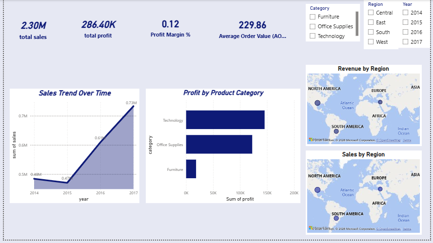
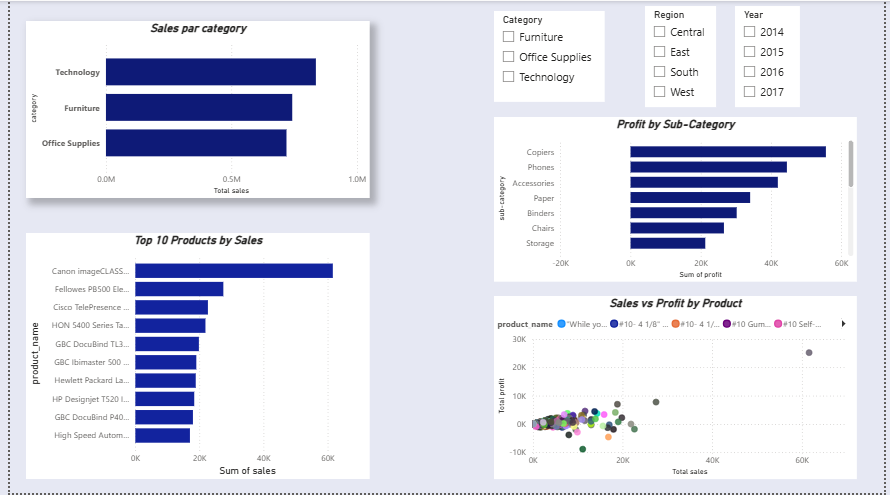

# Retail-Sales-Performance-Analysis
The objective of this project is to design and implement a Business Intelligence solution that  transforms raw retail sales data into meaningful insights through data modeling, dashboards,  and KPIs. The solution will support strategic and operational decision-making by providing a  clear overview of business performance. 

##  Industry & Organization Description

* **Industry:** Retail / E-commerce
* **Overview:** A medium-sized omnichannel retailer operating physical stores and online channels, offering products across **Furniture, Office Supplies, and Technology**. 
* **The Challenge:** While the company generates high volumes of daily transactional sales data across multiple regions, it currently relies on static reporting. This leaves decision-makers without interactive insights to optimize pricing, inventory, or regional performance.

---

##  Business Problem & Objectives

### Business Problem
Management faces critical visibility gaps due to:
* Limited insight into sales and profit performance across regions and categories.
* Difficulty identifying top-performing vs. underperforming products.
* Lack of clarity on customer contribution to revenue and purchasing behavior.
* Inability to track historical sales trends and detect seasonality.

### Project Objective
Design and implement an end-to-end **Business Intelligence solution** that transforms raw transactional data into actionable insights through data modeling, interactive dashboards, and core KPIs to support strategic decision-making.

---

##  Key Analytical Questions

The BI solution is engineered to answer:
1. What is the total revenue generated over time (monthly/yearly)?
2. Which product categories drive the highest revenue and profit?
3. Which regions contribute the most and least to total sales?
4. How does profit margin vary across products and regions?
5. Who are the top 10 customers by revenue generation?
6. What is the average order value (AOV)?
7. How do sales and profits evolve year-over-year?
8. Which products are underperforming?
9. Are there distinct seasonal patterns in sales performance?
10. How does customer purchasing behavior differ by region?

---

##  Key Performance Indicators (KPIs)

| KPI | Description |
| :--- | :--- |
| **Total Revenue** | Total sales value generated |
| **Total Profit** | Net profit (sales minus costs) |
| **Profit Margin (%)** | Ratio of profit to total revenue |
| **Number of Orders** | Total count of customer orders |
| **Average Order Value (AOV)** | Average revenue generated per order |
| **Sales Growth Rate (%)** | Period-over-period sales growth |
| **Revenue per Customer** | Average revenue contribution per customer |
| **Top Product Contribution (%)** | Percentage of total revenue from top products |

##  Dashboard Showcase

### Dashboard Page 1: Key Performance Indicators & Global Sales/Profit Overview
*Features high-level executive cards (**$2.30M** total sales, **$286.40K** profit, **0.12** profit margin, and **$229.86** AOV), global geographic distribution maps, and macro-level sales trends.*
[cite: 2]

### Dashboard Page 2: Product & Sub-Category Performance Analysis
*Provides granular deep-dives into category performance, top 10 products by sales, sub-category profit breakdowns, and individual product scatter analysis.*
[cite: 1]

---

##  Key Insights & Findings

* **Top Driver:** **Technology** is the most profitable product category.
* **Profitability Risks:** Specific sub-categories (e.g., **Tables**) are consistently operating at a loss.
* **Growth Trend:** Sales show a strong upward trend over time with clear historical growth patterns.

---

##  Business Recommendations

1. **Invest Capital:** Increase investment and stock allocation in high-profit categories and top-performing products.
2. **Optimize Sub-Categories:** Reevaluate, reprice, or optimize loss-making sub-categories (such as tables).
3. **Strategic Planning:** Use historical sales trends for demand forecasting and inventory planning.
4. **Margin Expansion:** Implement strategic initiatives to improve profitability in low-margin categories.

---

## ⚠️ Limitations & Future Improvements

### Limitations
* **Historical Data Only:** Analysis relies strictly on historical transactional records.
* **Limited Granularity:** Restricted cost granularity and limited customer detail.
* **External Factors:** Macroeconomic variables, marketing campaigns, and competitor pricing are excluded.

### Future Improvements
* **Real-Time Data Integration:** Connect live data pipelines for real-time reporting.
* **Predictive Analytics:** Implement forecasting models for advanced sales predictions.
* **Customer Segmentation:** Apply advanced behavioral segmentation (e.g., RFM analysis).
